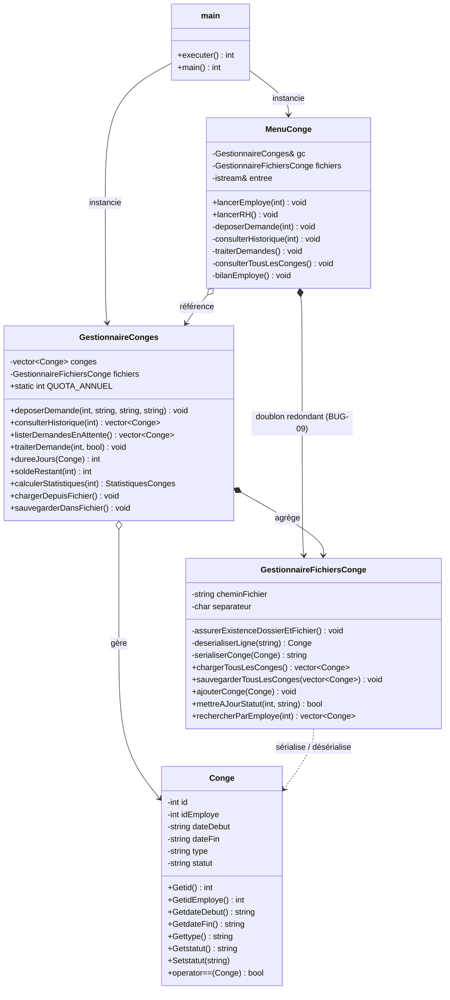

# Rapport de Test & Analyse d'Architecture : Gestion des Congés

**Rôles :** Senior C++ Systems Engineer & Lead QA  
**Date :** 21 novembre 2026  
**Projet :** Système de Gestion des Congés (Application console C++17)  
**Branche :** `Gestion_Conges` (comparée à `main` commit `7a69de9`)  
**Environnements de test :** Linux (g++ 16.2.1) & Windows (g++ 16.2.0 UCRT64 / MSYS2)  

---

## 1. Résumé Exécutif

| Élément | Statut | Observations |
|---|---|---|
| **Build Manuel (`g++`)** | **SUCCÈS** | `g++ -std=c++17 -Wall -Wextra -Wpedantic` compile avec 0 warning. |
| **Build `make` (README)** | **ÉCHEC** | `Makefile` absent à la racine (voir **BUG-01**). |
| **Sanitizers (ASan / UBSan)** | **SUCCÈS** | 0 fuite mémoire, 0 comportement indéfini détecté lors des tests. |
| **Suite de Tests Automatisés** | **44 Réussis / 0 Échoué** | 100 % des tests existants passent. |
| **Évaluation Globale** | **B+ (Bon avec réserves majeures)** | L'application respecte les principes RAII et évite les fuites mémoire, mais présente des faiblesses critiques : absence de rollback en cas d'erreur disque, désérialisation de fichiers aveugle, et cumul inter-annuel erroné des quotas de congés. |

---

## 2. Architecture & Analyse du Projet

### 2.1 Arborescence du Code Source

```text
Systeme-Gestion-Employees-Gestion_Conges/
├── main.cpp                        # Point d'entrée de l'application & boucle interactive
├── test_conges.cpp                 # Suite de 44 tests de validation et de régression
├── README.md                       # Guide d'exécution et règles métier
├── data/
│   └── conges.txt                  # Fichier de persistance (format: id;idEmploye;debut;fin;type;statut)
├── docs/                           # Documentation métier, diagrammes UML et spécifications SQL
│   ├── gestion_employes.sql        # Schéma relationnel (sur main)
│   └── sequence 9 - ...            # Diagrammes de cas d'utilisation et de séquence
├── include/
│   ├── Conge.h                     # Modèle de données pour un congé
│   ├── GestionnaireConges.h        # Logique métier, calcul des soldes et cache mémoire
│   ├── GestionnaireFichiersConge.h # Couche d'accès fichier (I/O, parsing, sérialisation)
│   └── MenuConge.h                 # Vues console (Espace Employé & Espace RH)
└── src/
    ├── Conge.cpp                   # Implémentation de la classe Conge
    ├── GestionnaireConges.cpp      # Règles de gestion (chevauchement, durée, quota)
    ├── GestionnaireFichiersConge.cpp # Écriture / lecture sur disque
    └── MenuConge.cpp               # Contrôleur d'entrées utilisateur et affichage
```

### 2.2 Diagramme de Classes et de Flux de Données



---

## 3. Rapport Détaillé des Anomalies & Bugs

### 3.1 Gravité Haute (Majeurs / Bloquants)

#### [BUG-01] Absence du `Makefile` documenté dans le README
- **Localisation :** Racine du projet / `README.md`
- **Catégorie :** Build & Configuration
- **Symptôme :** Le README annonce des commandes simples (`make`, `make run`, `make test`, `make clean`). L'exécution de `make` échoue immédiatement avec : `No targets specified and no makefile found`.
- **Impact :** Friction critique à l'intégration, échec des pipelines CI/CD automatisés et mauvaise expérience développeur.
- **Solution suggérée :** Ajouter un `Makefile` standard à la racine :
```makefile
CXX = g++
CXXFLAGS = -std=c++17 -Wall -Wextra -Wpedantic -Iinclude
SRC = src/Conge.cpp src/GestionnaireConges.cpp src/GestionnaireFichiersConge.cpp src/MenuConge.cpp

all: gestion_conges test_conges

gestion_conges: main.cpp $(SRC)
	$(CXX) $(CXXFLAGS) $^ -o $@

test_conges: test_conges.cpp $(SRC)
	$(CXX) $(CXXFLAGS) $^ -o $@

run: gestion_conges
	./gestion_conges

test: test_conges
	./test_conges

clean:
	rm -f gestion_conges gestion_conges.exe test_conges test_conges.exe
```

---

#### [BUG-02] Absence de Rollback lors d'un échec d'écriture disque
- **Localisation :** `src/GestionnaireConges.cpp:122-124` et `src/GestionnaireConges.cpp:249-251`
- **Catégorie :** Intégrité des données / État mémoire vs Disque
- **Symptôme :** Lors de `deposerDemande()`, l'élément est inséré en mémoire (`conges.push_back()`) *avant* la tentative d'écriture disque (`sauvegarderDansFichier()`). Si le fichier est en lecture seule (`chmod 444`), ou que le disque est plein :
  1. Une exception `runtime_error` est levée.
  2. Mais l'objet reste présent dans `conges`.
  3. L'utilisateur voit sa demande dans son historique pendant la session, alors qu'elle n'est pas persistée et disparaît au redémarrage.
- **Solution suggérée :** Effectuer l'écriture sur fichier temporaire atomique avant validation en mémoire, ou implémenter un rollback par `conges.pop_back()` :
```diff
--- a/src/GestionnaireConges.cpp
+++ b/src/GestionnaireConges.cpp
@@ -122,3 +122,9 @@ void GestionnaireConges::deposerDemande(...) {
     conges.push_back(nouvelleDemande);
-    sauvegarderDansFichier();
+    try {
+        sauvegarderDansFichier();
+    } catch (...) {
+        conges.pop_back();
+        throw;
+    }
```

---

#### [BUG-03] Désérialisation sans validation sémantique (`conges.txt`)
- **Localisation :** `src/GestionnaireFichiersConge.cpp:39-61` (`deserialiserLigne`)
- **Catégorie :** Sécurité / Intégrité des données
- **Symptôme :** Le README stipule : *« Si une ligne est invalide, l'application s'arrête avec un message clair »*. Or, `deserialiserLigne` vérifie seulement le nombre de champs et le typage numérique des deux IDs. Si `conges.txt` contient :
  - Une date inversée (`2026-12-05;2026-12-01`), les statistiques affichent : `Total jours pris : -3`.
  - Des dates inexistantes (`2026-02-31`), un type ou statut inventé (`Foo;Bar`), l'application démarre sans alerte.
- **Solution suggérée :** Réutiliser la validation métier (`dateValide`, `debut <= fin`, énumérations autorisées) dès la lecture dans `deserialiserLigne`.

---

#### [BUG-04] Fuite de Quota Multi-Année dans `soldeRestant`
- **Localisation :** `src/GestionnaireConges.cpp:254-266`
- **Catégorie :** Règle Métier / Logique
- **Symptôme :** La méthode `soldeRestant(int idEmploye)` cumule **tous les congés annuels acceptés dans l'historique sans filtrer l'année calendaire** :
```cpp
for (const Conge& c : conges) {
    if (c.GetidEmploye() == idEmploye && c.Gettype() == "Annuel" && estAcceptee(c.Getstatut())) {
        pris += dureeJours(c);
    }
}
return QUOTA_ANNUEL - pris;
```
Si un employé prend ses 22 jours en 2026, son solde calculé pour l'année 2027 sera de `22 - 22 = 0`. Tout nouveau dépôt pour 2027 déclenchera faussement l'alerte de dépassement de quota annuel.
- **Solution suggérée :** Filtrer le solde restant par année :
```cpp
int GestionnaireConges::soldeRestant(int idEmploye, int annee) const {
    int pris = 0;
    for (const Conge& c : conges) {
        if (c.GetidEmploye() == idEmploye
            && c.Gettype() == "Annuel"
            && estAcceptee(c.Getstatut())
            && c.GetdateDebut().substr(0, 4) == to_string(annee)) {
            pris += dureeJours(c);
        }
    }
    return QUOTA_ANNUEL - pris;
}
```

---

### 3.2 Gravité Moyenne

#### [BUG-05] Doublon d'instance `GestionnaireFichiersConge` dans `MenuConge`
- **Localisation :** `include/MenuConge.h:33` et `src/MenuConge.cpp:320`
- **Catégorie :** Architecture / Synchronisation d'état
- **Symptôme :** `MenuConge` instancie son propre `fichiers` en plus de celui encapsulé dans `GestionnaireConges gc`. Dans `MenuConge::consulterTousLesConges()`, il fait un appel direct `fichiers.chargerTousLesConges()`. En cas d'échec d'écriture ou de modification non synchronisée, l'Espace RH consulte une source divergente de celle utilisée pour le traitement des demandes en attente.
- **Solution :** Supprimer le membre `fichiers` de `MenuConge` et déléguer la consultation complète à `gc`.

#### [BUG-06] Vérification lexicographique des chevauchements de dates
- **Localisation :** `src/GestionnaireConges.cpp:67-68` et `src/GestionnaireConges.cpp:197-198`
- **Catégorie :** Robustesse / Cas limites
- **Symptôme :** L'évaluation `debut <= c.GetdateFin() && c.GetdateDebut() <= fin` s'appuie sur la comparaison lexicographique de `std::string`. Si une chaîne contient un caractère non visible, un retour chariot résiduel `\r` ou un format mal nettoyé, le test produit de faux négatifs.
- **Solution :** Utiliser les entiers `joursDepuisEpoque(date)` déjà disponibles dans la classe pour comparer des durées fiables.

---

### 3.3 Gravité Basse (Mineurs & Qualité de Code)

| ID | Titre | Fichier:Ligne | Description |
|---|---|---|---|
| **BUG-07** | Parsing permissif `std::stoi` sur l'ID employé | `main.cpp:35` | `stoi` convertit `"12abc"`, `"7.9"` ou `"+4"` en 12, 7 ou 4 sans lever d'erreur pour les caractères résiduels. |
| **BUG-08** | Statut inconnu interprété comme `[EN ATTENTE]` | `src/MenuConge.cpp:117` | Dans `indicateurStatut`, si le statut en base n'est ni `"Acceptée"` ni `"Refusée"`, la méthode retourne `"[EN ATTENTE]"` par défaut. |
| **BUG-09** | Erreur trompeuse si exécuté hors du dossier | `src/GestionnaireFichiersConge.cpp:16` | L'application cherche `data/` en relatif. Si lancée depuis un autre répertoire, le message mentionne un format de fichier incorrect au lieu du problème de chemin d'exécution. |
| **BUG-10** | Contrat partiel sur `Conge::operator==` | `src/Conge.cpp:58-60` | Compare uniquement `id == autre.id`. Deux objets distincts non persistés avec `id = 0` sont évalués comme égaux. |
| **BUG-11** | Pollution de l'espace de nommage global | `include/Conge.h:6`, `include/GestionnaireConges.h:10` | Présence de `using namespace std;` dans des en-têtes `.h`, contaminant toute unité de traduction les incluant. |

---

## 4. Cohérence & Écart avec le Schéma SQL (`main`)

En comparant avec le fichier `docs/gestion_employes.sql` ajouté sur `main` (commit `7a69de9`) :

| Fonctionnalité | Implémentation C++ (`Gestion_Conges`) | Schéma SQL (`main`) |
|---|---|---|
| **Stockage** | Fichier plat `data/conges.txt` | Table relationnelle MySQL `conge` |
| **Types autorisés** | `Annuel`, `Maladie`, `Sans solde`, `Exceptionnel` | `annuel`, `maladie`, `maternite`, `paternite`, `sans_solde`, `exceptionnel` |
| **Statuts autorisés** | `En attente`, `Acceptée`, `Refusée` | `en_attente`, `approuve`, `refuse`, `annule` |
| **Clé étrangère Employé** | Tout ID entier > 0 | `FOREIGN KEY (id_employe) REFERENCES employe(id)` |
| **Validation Dates** | Validation au dépôt uniquement | Contrainte SQL `CHECK (date_fin >= date_debut)` |

---

## 5. Tests Supplémentaires Recommandés pour la QA

1. **Test Quota Multi-Année (`test_solde_multi_annees`) :**
   - *Scénario :* Poser 22 jours en 2026. Vérifier que pour toute demande en 2027, le solde disponible est bien réinitialisé à 22 jours.
2. **Test Injection de Fichier Forgé / Données Invalides (`test_fichier_invalide_rejet`) :**
   - *Scénario :* Écrire une ligne avec date début postérieure à la fin ou statut inconnu dans `data/conges.txt`. Vérifier que l'application s'arrête immédiatement avec un code d'erreur explicite.
3. **Test Échec Disque / Transaction (`test_transaction_rollback_sur_echec_io`) :**
   - *Scénario :* Simuler un flux disque non disponible lors de l'enregistrement et valider que l'état interne de `GestionnaireConges` ne retient pas la demande rejetée.
4. **Test Délimiteurs et Caractères Parasites (`test_trailing_semicolons`) :**
   - *Scénario :* Charger des lignes avec points-virgules surnuméraires en fin de ligne (`...;Acceptée;;`) et certifier le bon comportement du parser.
