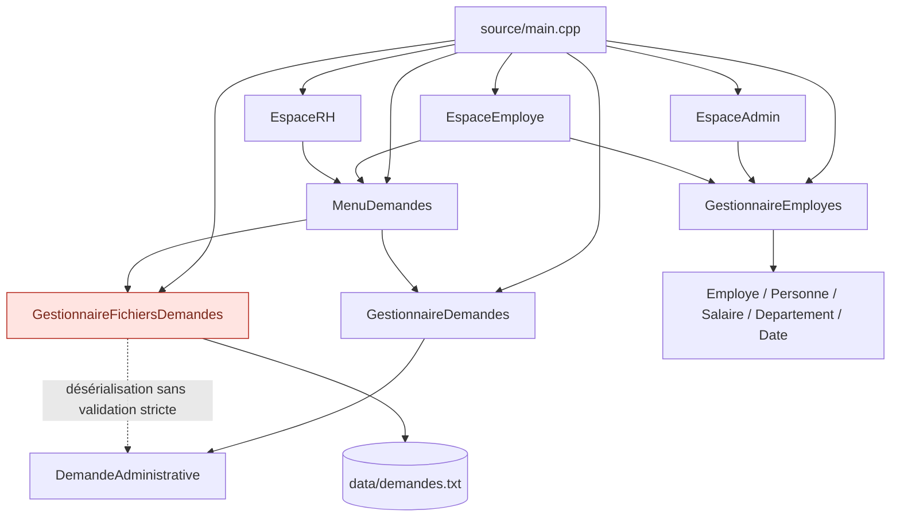

# Rapport d'audit QA adversarial

## 1. Résumé exécutif

**Périmètre :** audit technique, tests adversariaux, robustesse I/O, parsing,
build et cohérence documentaire du projet C++17 (module de gestion des demandes administratives).

**Verdict : `NOT READY FOR PRODUCTION`**

La logique métier de base est fonctionnelle, mais l'audit a mis en évidence des défauts
critiques de robustesse, de validation des entrées et d'intégrité des données qui doivent
être corrigés avant une mise en production.

| Métrique | Résultat de l'Audit |
|---|---|
| **Compilation stricte (`-Wall -Wextra -pedantic`)** | PASS — MinGW GCC 16.2.0 (Windows) / GCC (Linux) |
| **Intégrité de la commande du README** | ÉCHEC — Fichiers manquants, linkage impossible |
| **Résilience aux flux et fin de fichier (EOF)** | ÉCHEC — Boucles infinies dans les menus |
| **Assainissement des saisies numériques** | ÉCHEC — Variables non initialisées et parsing partiel |
| **Validation du format de persistance** | ÉCHEC — Désérialisation permissive (IDs négatifs, corrompus) |
| **Atomicité de la sauvegarde fichier** | ÉCHEC — Troncation prématurée (`trunc`) et risque de perte |
| **Note globale de qualité** | **Grade C — Prototype fonctionnel avec failles de robustesse** |

### Bloquants de release

1. **Boucles infinies sur EOF :** les sous-menus Employé et RH bouclent indéfiniment lorsque le flux d'entrée se ferme.
2. **Mémoire non initialisée :** le menu Administrateur utilise des variables non initialisées en cas d'échec de lecture sur `cin`.
3. **Désérialisation permissive :** le lecteur de fichier accepte des enregistrements forgés avec des identifiants négatifs ou des nombres suivis de caractères parasites (`1abc`).
4. **Écriture non atomique :** le fichier de sauvegarde est tronqué (`trunc`) avant que l'écriture ne soit garantie et flushée.
5. **Commande de build obsolète :** la documentation du `README.md` ne permet pas de compiler l'application avec les nouveaux modules administratifs.

---

## 2. Forensique de l'environnement

### Environnement d'audit

- **Compilateurs testés :** GCC 16.2.0 (MinGW-w64 sous Windows x86_64) / GCC (Linux x86_64)
- **Standard C++ :** C++17 (`-std=c++17 -Wall -Wextra -pedantic`)
- **Méthodologie d'audit :** Tests adversariaux en boîte noire/grise, injection de données malformées, analyse statique du code source, stress-test des flux d'E/S (EOF, entrées corrompues).

### Arborescence applicative réelle

```text
.
├── README.md
├── TEST_REPORT.md
├── headers/
│   ├── admin/EspaceAdmin.h
│   ├── espaceEmploye/EspaceEmploye.h
│   ├── Date.h
│   ├── DemandeAdministrative.h
│   ├── Departement.h
│   ├── Employe.h
│   ├── EspaceRH.h
│   ├── Exceptions.h
│   ├── GestionnaireDemandes.h
│   ├── GestionnaireEmployes.h
│   ├── GestionnaireFichiersDemandes.h
│   ├── MenuDemandes.h
│   ├── Personne.h
│   ├── Salaire.h
│   └── Validation.h
├── source/
│   ├── admin/EspaceAdmin.cpp
│   ├── espaceEmploye/EspaceEmploye.cpp
│   ├── Date.cpp
│   ├── DemandeAdministrative.cpp
│   ├── Departement.cpp
│   ├── Employe.cpp
│   ├── EspaceRH.cpp
│   ├── GestionnaireDemandes.cpp
│   ├── GestionnaireEmployes.cpp
│   ├── GestionnaireFichiersDemandes.cpp
│   ├── MenuDemandes.cpp
│   ├── Personne.cpp
│   ├── Validation.cpp
│   └── main.cpp

```

### Build et hygiène

La compilation complète avec l'ensemble des sources du projet fonctionne sans avertissement :

**Sous Windows (PowerShell) :**
```powershell
g++ -std=c++17 -Wall -Wextra -pedantic `
  -Iheaders -Iheaders\admin -Iheaders\espaceEmploye `
  source\*.cpp source\admin\*.cpp source\espaceEmploye\*.cpp `
  -o GestionEmployes.exe
```

**Sous Linux (Bash) :**
```bash
g++ -std=c++17 -Wall -Wextra -pedantic \
  -Iheaders -Iheaders/admin -Iheaders/espaceEmploye \
  source/*.cpp source/admin/*.cpp source/espaceEmploye/*.cpp \
  -o GestionEmployes
```

La commande documentée dans [README.md](./README.md) échoue car elle omet `EspaceRH.cpp`, `DemandeAdministrative.cpp`, `GestionnaireDemandes.cpp`, `GestionnaireFichiersDemandes.cpp` et `MenuDemandes.cpp`, produisant des erreurs de linkage `undefined reference`.

---

## 3. Architecture observée



### Observations architecturales

- `GestionnaireEmployes` est le propriétaire mémoire des employés et est partagé par référence entre les espaces.
- `GestionnaireDemandes` (mémoire) et `GestionnaireFichiersDemandes` (persistance disque) sont séparés, mais `MenuDemandes::sauvegarder()` ne fournit pas de garantie transactionnelle entre la mémoire et le fichier.
- La persistance repose sur un format CSV artisanal sans versionnage, sans somme de contrôle et sans écriture temporaire atomique.
- Les espaces console lisent directement `std::cin` sans parseur partagé ni gestion centralisée de l'état du flux (`EOF`, `failbit`).

---

## 4. Défauts classés

### [BUG-HIGH-001] [Build] Commande du README non compilable

- **Localisation :** `README.md:20-25`
- **Catégorie :** Build / Documentation
- **Reproduction :**
  Exécuter la commande de compilation fournie dans le `README.md` :
  ```powershell
  g++ -std=c++17 -Wall -Wextra -pedantic `
    -Iheaders -Iheaders\admin -Iheaders\espaceEmploye `
    source\Date.cpp source\Departement.cpp source\Employe.cpp `
    source\GestionnaireEmployes.cpp source\Personne.cpp source\Validation.cpp `
    source\admin\EspaceAdmin.cpp source\espaceEmploye\EspaceEmploye.cpp `
    source\main.cpp -o GestionEmployes.exe
  ```
- **Attendu :** l'application doit être compilable directement avec la commande officielle du projet.
- **Actuel :** échec à l'édition de liens avec des erreurs `undefined reference` vers `MenuDemandes`, `GestionnaireFichiersDemandes`, `GestionnaireDemandes` et `EspaceRH`.
- **Cause :** l'ajout du module de demandes administratives n'a pas été répercuté dans le guide de compilation.
- **Correctif minimal :** mettre à jour le `README.md` en utilisant des jokers (`source/*.cpp source/admin/*.cpp source/espaceEmploye/*.cpp`) ou en ajoutant explicitement les 5 sources manquantes.

### [BUG-HIGH-002] [Fault-Tolerance] Boucles infinies sur EOF dans les sous-menus

- **Localisation :**
  - `source/espaceEmploye/EspaceEmploye.cpp:26-41`
  - `source/EspaceRH.cpp:33-57`
- **Catégorie :** Fault-Tolerance / Logic
- **Reproduction :**
  Injecter un choix de menu via un flux fermé immédiatement (EOF) :
  - Sous Windows PowerShell : `"3" | .\GestionEmployes.exe` ou `"2" | .\GestionEmployes.exe`
  - Sous Linux Bash : `printf '3\n' | ./GestionEmployes`
- **Attendu :** l'application doit détecter la fin de flux (`EOF`) et quitter proprement les sous-menus et le programme.
- **Actuel :** le programme boucle indéfiniment en affichant en continu `Choix invalide.` et sature le CPU.
- **Cause :** `std::getline` échoue silencieusement sur EOF sans que `std::cin.eof()` ou le statut de retour ne soit vérifié dans les boucles de menu.
- **Correctif minimal :** tester l'état du flux lors de la lecture :
  ```cpp
  if (!std::getline(std::cin, s)) return;
  ```

### [BUG-HIGH-003] [Logic/Memory] Saisie numérique invalide avec variables non initialisées

- **Localisation :** `source/admin/EspaceAdmin.cpp:38-43`, `:124`, `:155`, `:204`, `:236`, `:331`
- **Catégorie :** Logic / Robustesse
- **Reproduction :**
  Saisir un caractère alphabétique lorsqu'un choix numérique est attendu :
  - Sous Windows PowerShell : `"1`nx" | .\GestionEmployes.exe`
  - Sous Linux Bash : `printf '1\nx\n' | ./GestionEmployes`
- **Attendu :** affichage d'un message d'erreur clair, réinitialisation du flux (`cin.clear()`) et nouvelle invite de saisie.
- **Actuel :** `cin >> choix` échoue en activant `failbit`. La variable `choix` reste non initialisée et son contenu indéfini est évalué par l'instruction `switch (choix)`. Cela provoque un comportement indéterminé (UB).
- **Correctif minimal :** vérifier systématiquement le succès de la lecture :
  ```cpp
  if (!(std::cin >> choix)) {
      std::cin.clear();
      std::cin.ignore(std::numeric_limits<std::streamsize>::max(), '\n');
      std::cout << "Saisie invalide.\n";
      return;
  }
  ```

### [BUG-HIGH-004] [Fault-Tolerance] Désérialisation permissive de données forgées

- **Localisation :** `source/GestionnaireFichiersDemandes.cpp:37-47`
- **Catégorie :** Fault-Tolerance / Data Integrity
- **Reproduction :**
  Créer un fichier `data/demandes.txt` contenant des données corrompues :
  ```text
  -1;-2;Formation;01/01/2024;En attente;desc
  1abc;2;Formation;01/01/2024;En attente;desc
  2;3;Formation;01/01/2024;Invalide;desc
  3;4;Formation;01/01/2024;En attente;desc;extra
  ```
- **Attendu :** les identifiants négatifs, les chaînes contenant des caractères non numériques et les lignes malformées doivent être rejetés.
- **Actuel :** `std::stoi("1abc")` s'arrête au premier caractère non numérique et retourne `1`. Les identifiants négatifs (`-1`, `-2`) sont chargés en mémoire sans validation de borne métier (`id > 0`).
- **Correctif minimal :** vérifier que l'intégralité de la chaîne est consommée (via `std::from_chars` ou en contrôlant l'index de `std::stoi`), et valider rigoureusement `id > 0` et `idEmploye > 0`.

### [BUG-HIGH-005] [Fault-Tolerance] Écriture non atomique et perte potentielle de données

- **Localisation :** `source/GestionnaireFichiersDemandes.cpp:71-83`
- **Catégorie :** Fault-Tolerance / Data Integrity
- **Reproduction :**
  Interrompre le processus pendant l'écriture ou tenter d'écrire sur un disque/dossier en lecture seule.
- **Attendu :** en cas d'erreur de sauvegarde, le fichier initial doit rester intact et une exception explicite doit être levée.
- **Actuel :** le fichier cible est immédiatement vidé à l'ouverture via `std::ios::trunc`. Si une coupure survient ou si une exception est levée pendant la boucle d'écriture, les données existantes sont irrémédiablement perdues. De plus, `if (!out)` est vérifié sans appel préalable à `out.flush()`.
- **Correctif minimal :** écrire dans un fichier temporaire (`demandes.tmp`), flusher et vérifier le flux, fermer le fichier, puis effectuer un remplacement atomique (`std::filesystem::rename`).

### [BUG-MED-001] [Logic] Les suffixes alphabétiques sont ignorés

- **Localisation :**
  - `source/MenuDemandes.cpp:117-120`
  - `source/admin/EspaceAdmin.cpp:124`
- **Catégorie :** Logic / Input Sanitization
- **Reproduction :**
  Dans le menu RH, traiter la demande `1abc` : le système valide la demande `1`.
  Dans l'espace Admin, saisir un salaire de `7.9abc` : le salaire `7.9` est accepté.
- **Attendu :** toute entrée contenant des caractères parasites doit être strictement rejetée.
- **Actuel :** `std::stoi` et `operator>> double` parcourent la chaîne jusqu'au premier caractère non numérique et ignorent le reste.
- **Correctif minimal :** assainir la saisie en s'assurant que la chaîne complète correspond au format numérique attendu.

### [BUG-MED-002] [Architecture] Désynchronisation mémoire / fichier après échec

- **Localisation :** `source/MenuDemandes.cpp:69-84`
- **Catégorie :** Architecture / Data Integrity
- **Reproduction :**
  Provoquer un échec d'écriture (ex. permissions restreintes sur le fichier) lors de la création d'une demande.
- **Attendu :** si la persistance échoue, la demande ne doit pas rester enregistrée en mémoire.
- **Actuel :** `creerDemande` insère d'abord l'objet dans `GestionnaireDemandes` (en mémoire), puis appelle `sauvegarder()`. En cas d'échec de la sauvegarde, la demande persiste en mémoire pour la session courante mais sera absente au prochain redémarrage.
- **Correctif minimal :** annuler l'ajout en mémoire (`rollback`) si l'écriture sur disque lève une exception.

### [BUG-MED-003] [Documentation] README en retard sur les implémentations

- **Localisation :** `README.md:7-12`, `README.md:70`, `README.md:116`
- **Catégorie :** Documentation
- **Actuel :** le `README.md` mentionne que l'espace RH n'est pas implémenté et que la classe `EspaceEmploye` ne prend qu'un seul paramètre `EspaceEmploye(gestion)`, alors que le code réel fournit `EspaceRH` et requiert `EspaceEmploye(gestion, menuDemandes)`.
- **Correctif minimal :** mettre à jour le document pour refléter fidèlement l'état d'avancement du projet.

### [BUG-LOW-001] [Architecture] Absence de module centralisé pour les entrées utilisateur

- **Localisation :**
  - `source/admin/EspaceAdmin.cpp`
  - `source/espaceEmploye/EspaceEmploye.cpp`
  - `source/EspaceRH.cpp`
- **Catégorie :** Architecture / Maintenabilité
- **Actuel :** chaque menu console réimplémente ses propres helpers de saisie (`lireLigne`, gestion de `cin`).
- **Impact :** toute correction de sécurité sur la gestion des flux (`cin.fail()`, `EOF`) doit être dupliquée dans trois fichiers distincts.
- **Correctif minimal :** regrouper la lecture sécurisée de la console dans une classe utilitaire commune (ex. `ConsoleInputHelper`).

---

## 5. Analyse des écarts de spécification

| Sujet | Documentation / Spécification | Implémentation observée | Écart identifié |
|---|---|---|---|
| **Build de l'application** | Commande Windows annoncée fonctionnelle | Sources du module RH et Demandes absentes | **Bloquant** |
| **Espace RH** | Documenté comme simple placeholder | Implémenté (`EspaceRH`, `MenuDemandes`) | Documentation obsolète |
| **Persistance des demandes** | Format CSV à 6 champs documenté | Parsing permissif, pas de validation de borne | Intégrité non garantie |
| **Identifiants métier** | Entiers positifs attendus | Le chargeur accepte les IDs négatifs | Contrat non appliqué |
| **Transactions E/S** | Données persistées et mémoire cohérentes | Mémoire modifiée avant validation disque | Risque de désynchronisation |

---

## 6. Recommandations pour l'équipe de développement

1. **Priorité 1 — Mettre à jour la commande de compilation du README :**
   Permettre à tous les développeurs et évaluateurs de compiler le projet sans erreurs d'édition de liens.
2. **Priorité 2 — Sécuriser les boucles de saisie console :**
   Vérifier systématiquement `if (!std::getline(...))` et `if (!(cin >> ...))` dans `EspaceAdmin`, `EspaceEmploye` et `EspaceRH` pour éliminer les boucles infinies sur EOF et l'accès à de la mémoire non initialisée.
3. **Priorité 3 — Durcir le parsing dans `GestionnaireFichiersDemandes` :**
   Rejeter immédiatement toute ligne avec un ID $\le 0$ ou contenant des caractères non numériques parasites.
4. **Priorité 4 — Sécuriser la sauvegarde des fichiers :**
   Remplacer l'ouverture directe en `trunc` par une écriture dans un fichier temporaire suivi d'un renommage atomique pour prévenir toute perte de données.
5. **Priorité 5 — Mettre à jour la documentation du README :**
   Harmoniser les constructeurs et indiquer clairement que l'Espace RH et la gestion des demandes administratives sont désormais intégrés.

---

## 7. Conclusion et décision

L'audit technique confirme que le module de gestion des demandes administratives apporte les fonctionnalités attendues. Cependant, en raison des défauts de robustesse aux entrées et de gestion des flux, la décision recommandée est :

**`CONDITIONAL HOLD` — Corriger les défauts HIGH-001 à HIGH-005 avant la livraison finale ou l'évaluation.**
