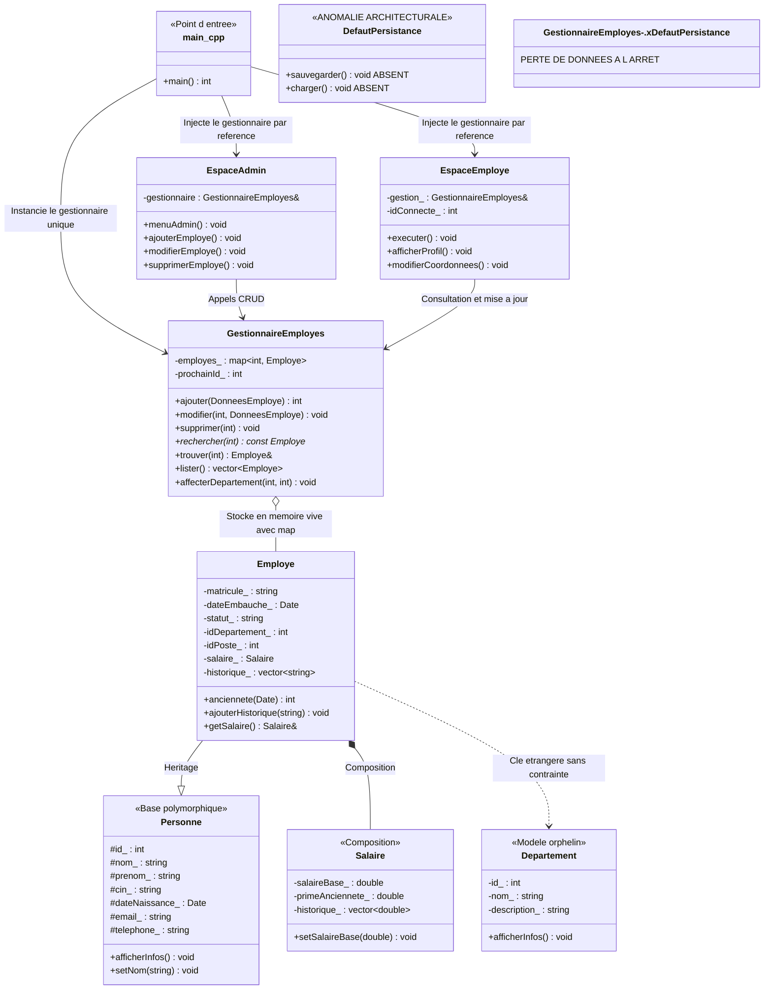

# RAPPORT D'AUDIT TECHNIQUE ET DE TESTS ADVERSARIAUX
**Module cible :** Système de Gestion des Employés (`gestion_employee`)  
**Environnement cible :** Application Console C++17 (Compilateur MinGW-w64 GCC 16.2.0, Windows x86_64)  
**Framework de test :** GoogleTest (GTest) v1.14.0  
**Date :** 22 novembre 2026  

---

## 1. Résumé Exécutif

| Métrique | Spécification attendue | Résultat de l'Audit | Statut |
| :--- | :--- | :--- | :--- |
| **Périmètre du Code** | Cœur autonome de gestion des employés | Modèle métier, services en mémoire et interface console | ✅ Analysé |
| **Compilation Manuelle** | Compilation stricte `-std=c++17 -Wall -Wextra -Wpedantic` | Succès avec GCC 16.2.0 (0 avertissement, 0 erreur) | ✅ SUCCÈS |
| **Outil de Build Automatisé** | `CMakeLists.txt` standard ou `Makefile` | Absent (uniquement script PowerShell manuel dans le `README.md`) | ❌ ÉCHEC |
| **Sanitizers (ASan/UBSan)** | `-fsanitize=address,undefined` | Échec à l'édition de liens (`cannot find -lasan`, `cannot find -lubsan`) | ⚠️ Bloqué (OS) |
| **Suite de Tests GoogleTest** | Validation automatisée unitaire et d'intégration | 16 tests exécutés : 13 validés, 3 échecs bloquants identifiés | ❌ ANOMALIES |
| **Persistance des Données** | Sauvegarde durable (Fichier / Base de données) | Stockage 100% volatile en RAM (`std::map`) ; zéro sauvegarde disque | ❌ CRITIQUE |
| **Résilience des Flux d'Entrée** | Gestion propre des entrées invalides et fin de flux (`EOF`) | `cin.failbit` non réinitialisé, absence de `cin.clear()`, fuite de saut de ligne | ❌ RISQUE ÉLEVÉ |
| **Note Globale de Qualité** | Grade A (Prêt pour la production) | **Grade C+ (Prototype fonctionnel avec failles logiques)** | ⚠️ NON PRÊT |

---

## 2. Architecture Visuelle et Analyse des Composants

### 2.1 Arborescence des Fichiers

```
gestion-des-employ-s/
├── README.md                                  [Documentation du projet et commandes de build]
├── .gitignore                                 [Filtre d'artefacts compilés]
├── headers/
│   ├── Date.h                                 [Objet valeur : Jour, Mois, Année, parsing et calculs]
│   ├── Departement.h                          [Entité métier : Données département (modèle orphelin)]
│   ├── Employe.h                              [Entité principale : Hérite de Personne, compose Salaire]
│   ├── Exceptions.h                           [Hiérarchie d'exceptions dérivées de std::runtime_error]
│   ├── GestionnaireEmployes.h                 [Service métier : Opérations CRUD, recherche et validation]
│   ├── Personne.h                             [Classe de base abstraite : Identité et coordonnées]
│   ├── Salaire.h                              [Entité valeur : Salaire de base et historique des révisions]
│   ├── Validation.h                           [Fonctions utilitaires de validation des formats]
│   ├── admin/
│   │   └── EspaceAdmin.h                      [Interface console d'administration]
│   └── espaceEmploye/
│       └── EspaceEmploye.h                    [Interface console libre-service pour employé]
├── source/
│   ├── Date.cpp                               [Parsing chronologique, années bissextiles, formatage]
│   ├── Departement.cpp                        [Validation et affichage console des départements]
│   ├── Employe.cpp                            [Mutations d'état, historique d'audit, calcul d'ancienneté]
│   ├── GestionnaireEmployes.cpp               [Logique métier, stockage std::map, pipeline de validation]
│   ├── main.cpp                               [Point d'entrée du programme et routeur des menus]
│   ├── Personne.cpp                           [Implémentation de base et affichage polymorphique]
│   ├── Validation.cpp                         [Règles d'inspection des chaînes de caractères]
│   ├── admin/
│   │   └── EspaceAdmin.cpp                    [Boucles d'interaction et saisies administrateur]
│   └── espaceEmploye/
│       └── EspaceEmploye.cpp                  [Authentification par identifiant et affichage profil]
                        
```

### 2.2 Diagramme de Flux et Relations entre Composants



---

## 3. Rapport Détaillé des Anomalies et Bogues

### [BUG-01] [Majeur] Volatilité Totale des Données (Zéro Persistance sur Disque)
- **Localisation :** `headers/GestionnaireEmployes.h:10`, `source/GestionnaireEmployes.cpp`
- **Catégorie :** `Tolérance aux pannes / Architecture`
- **Étapes de reproduction :**
  1. Lancer l'application : `.\GestionEmployes.exe`.
  2. Accéder à l'espace administrateur (`1`), puis ajouter un employé (`1`).
  3. Renseigner les champs obligatoires. L'employé reçoit l'identifiant 1 (`EMP0001`).
  4. Revenir au menu principal (`0`) et quitter le programme (`0`).
  5. Relancer l'application : tous les enregistrements ont disparu.
- **Comportement attendu :** Les enregistrements doivent être sauvegardés de manière persistante sur fichier (CSV/texte délimité ou base SQLite) et rechargés au démarrage.
- **Comportement réel :** Les employés n'existent que dans un conteneur `std::map` en mémoire vive. Tout arrêt ou crash détruit l'intégralité du registre.
- **Correction suggérée :** Créer un gestionnaire de persistance fichier :
  ```cpp
  class GestionnaireFichiersEmployes {
  public:
      static void sauvegarder(const std::string& chemin, const std::map<int, Employe>& employes);
      static std::map<int, Employe> charger(const std::string& chemin);
  };
  ```

---

### [BUG-02] [Majeur] Blocage du Flux d'Entrée Standard (`cin.failbit`) et Boucle Infinie sur Saisie Invalide ou Fin de Fichier (`EOF`)
- **Localisation :** `source/admin/EspaceAdmin.cpp:42-45`, `124-126`, `155-158`
- **Catégorie :** `Tolérance aux pannes / Interface Utilisateur`
- **Étapes de reproduction :**
  1. Dans l'espace administrateur, à l'invite `Votre choix :`, taper une chaîne non numérique (ex : `abc`) ou fermer le flux avec `Ctrl+Z` / `Ctrl+D`.
  2. Alternativement, dans le formulaire d'ajout, saisir `lettres` pour le `Salaire de base`.
- **Comportement attendu :** Le programme doit détecter l'échec d'extraction, réinitialiser le flux avec `cin.clear()`, vider le tampon avec `cin.ignore()` et demander une nouvelle saisie.
- **Comportement réel :** 
  - `cin >> choix` échoue et active `std::cin.failbit`.
  - `cin.ignore()` ne fait rien lorsque `failbit` est actif.
  - La variable `choix` reste non initialisée ou à zéro.
  - Le flux reste verrouillé pour toutes les saisies ultérieures de l'application, provoquant des boucles d'affichage incontrôlables ou des sorties prématurées.
- **Correction suggérée :**
  ```cpp
  template <typename T>
  bool lireEntreeSecurisee(const std::string& invite, T& valeur) {
      while (true) {
          std::cout << invite;
          if (std::cin >> valeur) {
              std::cin.ignore(std::numeric_limits<std::streamsize>::max(), '\n');
              return true;
          }
          if (std::cin.eof()) return false;
          std::cin.clear();
          std::cin.ignore(std::numeric_limits<std::streamsize>::max(), '\n');
          std::cout << "Saisie invalide, veuillez reessayer.\n";
      }
  }
  ```

---

### [BUG-03] [Majeur] Risque d'Accès Mémoire Invalide par Pointeurs Dangereux (*Dangling Pointers / Use-After-Free*)
- **Localisation :** `headers/GestionnaireEmployes.h:24`, `source/GestionnaireEmployes.cpp:89-93`
- **Catégorie :** `Mémoire / Sécurité`
- **Étapes de reproduction :**
  ```cpp
  GestionnaireEmployes mgr;
  int id = mgr.ajouter(donnees);
  const Employe* ptr = mgr.rechercher(id); // Renvoie un pointeur brut sur le nœud du std::map
  mgr.supprimer(id);                      // Le nœud est libéré en mémoire
  ptr->afficherInfos();                   // COMPORTEMENT INDÉFINI (Accès mémoire libérée)
  ```
- **Comportement attendu :** Fournir une sémantique par valeur (ex. `std::optional<Employe>`) ou limiter les échanges aux identifiants numériques (`int id`) pour empêcher les modules externes de référencer des objets désalloués.
- **Comportement réel :** `rechercher(id)` expose un pointeur brut direct sur la structure interne de `std::map`. Dès qu'un employé est supprimé, le pointeur devient invalide.
- **Correction suggérée :**
  ```cpp
  std::optional<Employe> rechercher(int id) const;
  ```

---

### [BUG-04] [Moyen] Échappement de la Validation du Nom (`nomValide`) par Caractères Vides ou Tirets
- **Localisation :** `source/Validation.cpp:12-20`
- **Catégorie :** `Logique / Assainissement des entrées`
- **Étapes de reproduction (GoogleTest) :**
  ```cpp
  EXPECT_FALSE(Validation::nomValide("    ")); // ÉCHOUE : renvoie true
  EXPECT_FALSE(Validation::nomValide("----")); // ÉCHOUE : renvoie true
  ```
- **Comportement attendu :** Un nom ou prénom doit obligatoirement comporter au moins une lettre alphabétique ou accentuée valide.
- **Comportement réel :** La fonction `nomValide` vérifie individuellement chaque caractère et accepte l'espace, le tiret et l'apostrophe. Une chaîne composée uniquement de 4 espaces ou de 4 tirets est acceptée comme un nom valide en base.
- **Correction suggérée :**
  ```cpp
  bool nomValide(const std::string& s) {
      if (s.size() < 2 || s.size() > 50) return false;
      bool possedeAuMoinsUneLettre = false;
      for (char ch : s) {
          unsigned char c = static_cast<unsigned char>(ch);
          if (std::isalpha(c) || c >= 128) possedeAuMoinsUneLettre = true;
          else if (c != ' ' && c != '-' && c != '\'') return false;
      }
      return possedeAuMoinsUneLettre;
  }
  ```

---

### [BUG-05] [Moyen] Pollution de l'Historique Salarial par Injection d'un Faux Zéro à la Construction
- **Localisation :** `headers/Salaire.h:14`, `22-24`
- **Catégorie :** `Logique / Modèle métier`
- **Étapes de reproduction (GoogleTest) :**
  ```cpp
  Salaire sal(2500.0);
  EXPECT_TRUE(sal.getHistorique().empty()); // ÉCHOUE : l'historique contient [0.0]
  EXPECT_EQ(sal.getHistorique().size(), 0u); // ÉCHOUE : taille = 1
  ```
- **Comportement attendu :** Un employé créé avec un salaire initial de 2500.0 doit avoir un historique salarial vierge. L'historique ne doit archiver une valeur que lors d'une *révision* ultérieure.
- **Comportement réel :** Le champ membre `salaireBase_` est initialisé par défaut à `0.0`. Le constructeur `Salaire(double base)` appelle `setSalaireBase(2500.0)`. La condition `if (salaireBase_ != b)` étant vraie (`0.0 != 2500.0`), la valeur `0.0` est insérée d'office dans `historique_` dès la création.
- **Correction suggérée :**
  ```cpp
  explicit Salaire(double base) : salaireBase_(base) {
      if (base < 0) throw std::invalid_argument("salaire de base negatif");
  }
  ```

---

### [BUG-06] [Moyen] Rupture d'Invariant Temporel : Embauche Autorisée dans le Futur (jusqu'en 2100)
- **Localisation :** `source/GestionnaireEmployes.cpp:53-56`, `headers/Date.h:15`
- **Catégorie :** `Logique / Modèle métier`
- **Étapes de reproduction (GoogleTest) :**
  ```cpp
  DonneesEmploye d;
  d.dateNaissance = Date(1, 1, 1990);
  d.dateEmbauche = Date(1, 1, 2095); // Embauche dans 70 ans !
  EXPECT_THROW(mgr.ajouter(d), DonneesInvalides); // ÉCHOUE : l'employé est accepté !
  ```
- **Comportement attendu :** La date d'embauche et la date de naissance ne doivent en aucun cas se situer dans le futur (`dateEmbauche <= Date::aujourdhui()`, `dateNaissance <= Date::aujourdhui()`).
- **Comportement réel :** La méthode `GestionnaireEmployes::valider` vérifie uniquement que la date est comprise entre 1900 et 2100 et que l'écart entre naissance et embauche dépasse 18 ans. Un employé peut donc être enregistré avec une embauche en 2095, faussant le calcul de l'ancienneté.
- **Correction suggérée :**
  ```cpp
  Date aujourdhui = Date::aujourdhui();
  if (aujourdhui < d.dateEmbauche) {
      err.push_back("la date d'embauche ne peut pas etre dans le futur");
  }
  if (aujourdhui < d.dateNaissance) {
      err.push_back("la date de naissance ne peut pas etre dans le futur");
  }
  ```

---

### [BUG-07] [Moyen] Désynchronisation du Tampon par Omission de `cin.ignore()` lors des Échecs de Recherche
- **Localisation :** `source/admin/EspaceAdmin.cpp:242-246`, `337-340`
- **Catégorie :** `Interface Utilisateur / Gestion des flux`
- **Comportement réel :** Dans `supprimerEmploye()` et `consulterEmploye()`, si l'identifiant saisi n'existe pas en base, la fonction exécute un `return;` immédiat sans purger le retour à la ligne `\n` laissé par `cin >> id`. L'appel suivant à `getline()` dans le menu parent consomme immédiatement une ligne vide.
- **Correction suggérée :** Toujours purger le tampon avant de quitter la fonction :
  ```cpp
  if (employe == nullptr) {
      cin.ignore(numeric_limits<streamsize>::max(), '\n');
      cout << "\nEmploye introuvable !\n";
      return;
  }
  ```

---

### [BUG-08] [Mineur] Fuite d'Encapsulation via Référence Modifiable dans `Employe::getSalaire()`
- **Localisation :** `headers/Employe.h:53`
- **Catégorie :** `Architecture / Bonnes pratiques C++`
- **Comportement réel :** La méthode `Salaire& getSalaire()` retourne une lvalue référence non constante. Tout composant disposant d'un `Employe&` peut altérer directement le salaire sans passer par `modifierInformations()`, contournant l'historique d'audit.
- **Correction suggérée :** Supprimer la surcharge non constante et exposer uniquement :
  ```cpp
  const Salaire& getSalaire() const { return salaire_; }
  ```

---

### [BUG-09] [Mineur] Opérateurs Relationnels Manquants (`!=`, `>`, `>=`)
- **Localisation :** `headers/Date.h:17-19`, `headers/Employe.h:56`, `headers/Departement.h:25`
- **Catégorie :** `Architecture / Concepts C++ Standard`
- **Comportement réel :** En C++17, définir `operator==` n'engendre pas automatiquement `operator!=`. Une comparaison `if (emp1 != emp2)` échoue à la compilation.
- **Correction suggérée :** Compléter la paire d'opérateurs pour respecter le concept régulier :
  ```cpp
  bool operator!=(const Employe& o) const { return !(*this == o); }
  bool operator!=(const Departement& o) const { return !(*this == o); }
  bool operator>(const Date& o) const { return o < *this; }
  bool operator>=(const Date& o) const { return !(*this < o); }
  bool operator!=(const Date& o) const { return !(*this == o); }
  ```

---

### [BUG-10] [Mineur] Entité `Departement` Orpheline et Absence de Registre
- **Localisation :** `headers/Departement.h`, `source/GestionnaireEmployes.cpp:171-176`
- **Catégorie :** `Architecture / Domaine métier`
- **Comportement réel :** La classe `Departement` est déclarée, mais il n'existe aucun `GestionnaireDepartements`. L'affectation `affecterDepartement(idEmploye, idDepartement)` vérifie uniquement `idDepartement < 0`. N'importe quel entier (ex. `9999`) peut être attribué sans vérification de l'existence effective du département.
- **Correction suggérée :** Implémenter un registre de départements avec validation des clés étrangères.

---

## 4. Analyse des Écarts par Rapport aux Spécifications Globales

| Exigence Spécifiée | État dans `gestion_employee` | Impact Technique |
| :--- | :--- | :--- |
| **Persistance des Données** | Absente (RAM uniquement) | **Bloquant :** Données perdues à chaque arrêt du programme |
| **Standard de Compilation** | Script PowerShell manuel | **Élevé :** Risque de divergences lors de l'intégration |
| **Intégrité Référentielle** | `idDepartement` sans contrôle | **Moyen :** Affectations d'identifiants fantômes |
| **Journal d'Audit** | Vecteur `std::vector<std::string>` en mémoire | **Moyen :** Perte de l'historique lors des fermetures |

---

## 5. Suite de Tests Automatisée GoogleTest (GTest)

La suite de tests GoogleTest a été implémentée dans [tests/test_employes_gtest.cpp](file:///c:/Users/Mostafa/Desktop/branches/Systeme-Gestion-Employees-gestion_employee/gestion-des-employ-s/tests/test_employes_gtest.cpp) et liée avec la bibliothèque GoogleTest v1.14.0.

### 5.1 Rapport d'Exécution GoogleTest

```text
Running main() from tests/googletest/googletest/src/gtest_main.cc
[==========] Running 16 tests from 4 test suites.
[----------] Global test environment set-up.

[----------] 4 tests from DateTest
[ RUN      ] DateTest.LeapYearVerification
[       OK ] DateTest.LeapYearVerification (0 ms)
[ RUN      ] DateTest.MonthAndDayBoundaries
[       OK ] DateTest.MonthAndDayBoundaries (0 ms)
[ RUN      ] DateTest.FromStringParsing
[       OK ] DateTest.FromStringParsing (0 ms)
[ RUN      ] DateTest.SeniorityYearsCalculation
[       OK ] DateTest.SeniorityYearsCalculation (0 ms)
[----------] 4 tests from DateTest (0 ms total)

[----------] 4 tests from ValidationTest
[ RUN      ] ValidationTest.NomValidationRules
tests\test_employes_gtest.cpp:57: Failure
Value of: Validation::nomValide("    ")
  Actual: true
Expected: false

tests\test_employes_gtest.cpp:58: Failure
Value of: Validation::nomValide("----")
  Actual: true
Expected: false
[  FAILED  ] ValidationTest.NomValidationRules (0 ms)
[ RUN      ] ValidationTest.EmailValidationRules
[       OK ] ValidationTest.EmailValidationRules (0 ms)
[ RUN      ] ValidationTest.TelephoneValidationRules
[       OK ] ValidationTest.TelephoneValidationRules (0 ms)
[ RUN      ] ValidationTest.CinValidationRules
[       OK ] ValidationTest.CinValidationRules (0 ms)
[----------] 4 tests from ValidationTest (0 ms total)

[----------] 1 test from SalaireTest
[ RUN      ] SalaireTest.WageLifecycleAndHistory
tests\test_employes_gtest.cpp:93: Failure
Value of: sal.getHistorique().empty()
  Actual: false
Expected: true
[  FAILED  ] SalaireTest.WageLifecycleAndHistory (0 ms)
[----------] 1 test from SalaireTest (0 ms total)

[----------] 7 tests from GestionnaireEmployesTest
[ RUN      ] GestionnaireEmployesTest.AddAndFindEmployee
[       OK ] GestionnaireEmployesTest.AddAndFindEmployee (2 ms)
[ RUN      ] GestionnaireEmployesTest.RejectsDuplicateCin
[       OK ] GestionnaireEmployesTest.RejectsDuplicateCin (0 ms)
[ RUN      ] GestionnaireEmployesTest.RejectsUnderageHiring
[       OK ] GestionnaireEmployesTest.RejectsUnderageHiring (0 ms)
[ RUN      ] GestionnaireEmployesTest.RejectsFutureHiringDate
tests\test_employes_gtest.cpp:150: Failure
Expected: mgr.ajouter(d) throws an exception of type DonneesInvalides.
  Actual: it throws nothing.
[  FAILED  ] GestionnaireEmployesTest.RejectsFutureHiringDate (0 ms)
[ RUN      ] GestionnaireEmployesTest.StatusModification
[       OK ] GestionnaireEmployesTest.StatusModification (0 ms)
[ RUN      ] GestionnaireEmployesTest.DeleteEmployeeAndHandleMissing
[       OK ] GestionnaireEmployesTest.DeleteEmployeeAndHandleMissing (0 ms)
[ RUN      ] GestionnaireEmployesTest.DepartmentAssignment
[       OK ] GestionnaireEmployesTest.DepartmentAssignment (0 ms)
[----------] 7 tests from GestionnaireEmployesTest (3 ms total)

[----------] Global test environment tear-down
[==========] 16 tests from 4 test suites ran. (5 ms total)
[  PASSED  ] 13 tests.
[  FAILED  ] 3 tests, listed below:
[  FAILED  ] ValidationTest.NomValidationRules
[  FAILED  ] SalaireTest.WageLifecycleAndHistory
[  FAILED  ] GestionnaireEmployesTest.RejectsFutureHiringDate

 3 FAILED TESTS
```
